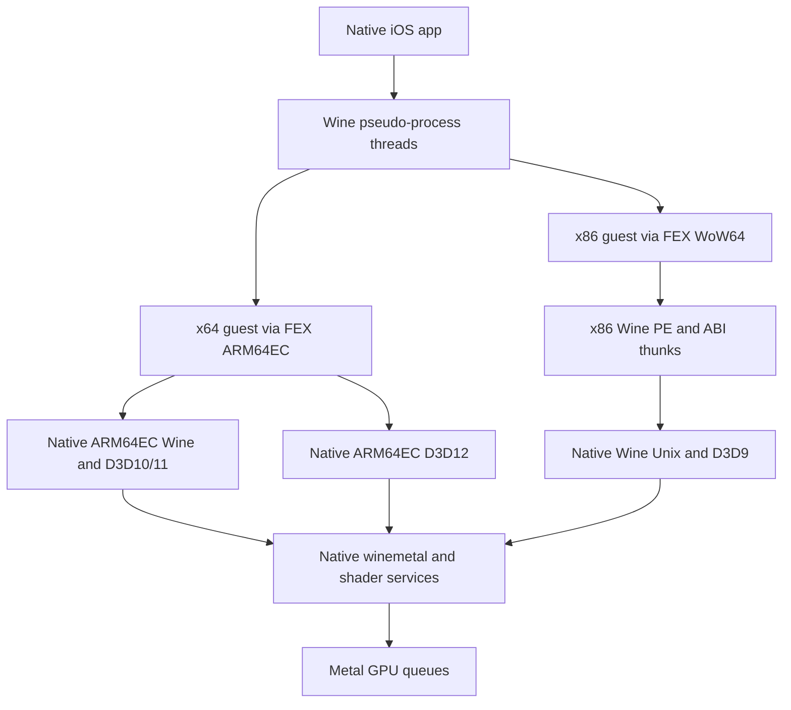

# Madeira performance architecture

Investigation date: 2026-10-10. Source snapshot: **48f976429c189f8396e23d251d8a82f43c705922**. This report describes that checkout, not every released IPA or later PR. Start with [recommendations](recommendations.md); subsystem details are in [FEX](fex.md), [Wine](wine.md), [graphics](dxmt.md), [cross-subsystem](cross-subsystem.md), and [benchmark plan](benchmark-plan.md).

## Evidence and limits

The four top-level submodules were retrieved at their exact gitlinks and inspected. FEX's pinned rpmalloc and vixl were also retrieved. Inspection traced active build inputs, not just similarly named upstream files. The environment is x86-64 Linux; no Xcode, iOS SDK, Metal device, simulator or physical iPad is available. Portable host tests were executed (benchmark plan records results). **No game performance, GPU timing, JIT throughput or speedup was measured in this investigation.** Historical numbers in comments/PRs are author reports, not results reproduced here.

Classification used throughout:

- **C — confirmed work/cost in source:** an operation or serialization is demonstrably present. This does not establish that it dominates a game or quantify its cost.
- **S — strongly supported opportunity:** a trace identifies an avoidable mechanism with a plausible change; benefit still needs device A/B testing.
- **H — profiling hypothesis:** an optimization is conditional on a measured bottleneck.

## Dependency and build identity

| Component | Exact source identity | Role / qualifications |
|---|---|---|
| Madeira | `48f976429c189f8396e23d251d8a82f43c705922` | Native app, Wine Unix overlays, D3D12 implementation, build integration |
| FEX fork | `3bec2ac498bf78156ab47c0c194b0e8cb2849756`, branch declaration `ios-port-2607` | Native ARM code generator, ARM64EC `xtajit64.dll`, aarch64 WoW64 `xtajit.dll`. Branch name is not proof of an upstream release equivalence |
| Wine fork | `257f271cfffed9f22f7987cac53bc00095d092fe`, `madeira-lgpl` | `VERSION` says Wine 11.4; substantial Madeira changes plus superproject Unix-side replacements |
| Wine comparison baseline | upstream `wine-11.4`, commit `cc893ef9cb17b994bfd1f1a1f7355be55e615623` | Retrieved from `wine-mirror/wine`; exact comparison used below |
| DXMT fork | `db546ee466ad50ec6463edb5fa183de11db43761`, `ios-port` | D3D10/11, native D3D9, winemetal, AIR compiler; not stock DXMT |
| Madeira Dock | `72558e416a390f3669457930f09a389e54f49556` | Steam launcher/client integration, not a CPU translator |
| FEX rpmalloc fork | `812c2b9cf4310ffacf14e6b64066e78ab0c394b5` | Custom allocation/VA-band behavior; source retrieved, no exhaustive allocator proof |
| FEX vixl | `5f418449c48f6ca3ad37c47ec632f17a561c0580` | Pinned emitter dependency; retrieved |
| DXMT DirectX headers / nvapi | `9df86f2341616ef1888ae59919feaa6d4fad693d` / `d08488fcc82eef313b0464db37d2955709691e94` | Nested gitlinks recorded; not populated for this documentation-only checkout |
| LLVM | build record names `8dfdcc7b7` | External checkout/build not present; full commit and actual deployed compiler provenance not verified |
| Metal Shader Converter | build record: 4.0 beta 2, package SHA-256 `1acc33c87ea663933df89721a998d066106685473020bcbe007cee7a16155734` | Proprietary input; internal implementation unavailable; do not infer converter internals |
| llvm-mingw | build record: `20260421-ucrt-macos-universal` | External toolchain not installed here |

Source of gitlinks/URLs: [.gitmodules:1–16](https://github.com/willfaust/Madeira/blob/48f976429c189f8396e23d251d8a82f43c705922/.gitmodules#L1-L16). Build recipes and missing inputs: [docs/BUILDING.md:1–82](https://github.com/willfaust/Madeira/blob/48f976429c189f8396e23d251d8a82f43c705922/docs/BUILDING.md#L1-L82). DXMT D3D9 provenance: `dxmt/LICENSE-MADEIRA.md`, importing `dacevedo12/dxmt` tag `v0.4-d3d9` with further Madeira work. Other support inputs include FFmpeg 7.1.1, GnuTLS 3.8.9, Nettle 3.10.1, GMP 6.3.0, Wine Mono 11.0.0 and the Rust pairing Cargo.lock. They matter to media, authentication and setup but were not treated as FEX/DXMT implementations.

`tools/source-manifest.py` records recursive gitlinks, checked-out commits and availability so the next agent can regenerate the complete nested dependency inventory. Unpopulated nested test/header/tool libraries are **not** silently assumed available. `docs/BUILDING.md` contains historical claims that forks were not pushed; the top-level pins above were actually fetchable during this investigation. Its clean-build and external-toolchain limitations still apply.

## Repository map and active overrides

| Path | What to inspect / edit |
|---|---|
| `app/Madeira/` | Swift UI, CPU/GPU overlay, JIT allocation, `WineProcessBridge.m`, `WineServerBridge.m`, `FEXBridge.mm`, `Winios/` display/input |
| `build/ntdll-unix/` | Active `process_ios.c`, `thread_ios.c`, `server_ios.c`, `loader_ios.c`, `virtual_ios.c`, `signal_arm64_ios.c`; linked into native ntdll Unix archive |
| `build/wineserver/` | Active `fd_ios.c`, `request_ios.c`, `main_ios.c`, queue/mapping/window replacements; stock fork server sources supply remaining objects |
| `build/madsync/` | Optional in-process ntsync-style implementation |
| `wine/dlls/ntdll/` | ARM64EC/PE loader and synchronization; `unix/sync.c` supplies fastsync; thread pool is here too |
| `FEX/Source/Windows/` | Actual Windows translator modules; `FEXCore/Source/Interface/` supplies decoder, IR, JIT, dispatcher, caches |
| `dxmt/src/` | D3D9/10/11 frontend, queue/tasks/resources, winemetal ABI and Unix Metal bridge, shader compiler/cache |
| `madeira-d3d12/` | Separate D3D12 PE runtime and native DXIL/DXBC conversion service |
| `build/*/build*.sh` | Which original and replacement sources are actually compiled, flags and staging destinations |
| `tests/` | Portable extracted-source/model checks and Windows guest executable tests |
| `research/remote-metal/` | Experimental transport work; not evidence that normal local rendering crosses a network |

There is no single patch directory that reconstructs this port: modifications live both in fork commits and in replacement sources in the superproject. Comparing only `wine/` misses much of the iOS adaptation.

## Native versus translated execution

ARM64EC is native ARM execution with an ABI compatible with x64 callers; it is not an x86 DLL translated wholesale. Third-party x64 game/middleware DLLs still execute via FEX. An x86 process also has translated i386 Wine PE modules; its aarch64 WoW64 support and native Unix services do not. D3D9's generated shim routes into a native frontend; x86 D3D10/11 frontend work can remain translated. The build explicitly compiles D3D9 and its DXMT substrate with `DXMT_NATIVE`, `DXMT_MADEIRA`, and `DXMT_IOS`, removing the PE-to-Unix transition inside that substrate: [build/dxmt-ios/build.sh:27–64](https://github.com/willfaust/Madeira/blob/48f976429c189f8396e23d251d8a82f43c705922/build/dxmt-ios/build.sh#L27-L64). Do not describe all DirectX calls as translated game instructions or all graphics frontend code as native.

`FEXBridge.mm` initializes a small native FEX harness and the executable pool. Its `g_current_thread` and minimal Linux syscall handler are **not** the Windows game's scheduler. Game translation uses the separately built `xtajit64.dll` / `xtajit.dll`; tuning only the static app FEX copy can miss the runtime entirely. See [build/fex-arm64ec/build.sh:1–16](https://github.com/willfaust/Madeira/blob/48f976429c189f8396e23d251d8a82f43c705922/build/fex-arm64ec/build.sh#L1-L16) and [FEX/Source/Windows/ARM64EC/Module.cpp:1780–1820](https://github.com/willfaust/FEX/blob/3bec2ac498bf78156ab47c0c194b0e8cb2849756/Source/Windows/ARM64EC/Module.cpp#L1780-L1820).

## One host process, many schedulable threads

`NtCreateUserProcess → spawn_process → pthread_create(ios_child_thread_entry) → wine_ios_child_main` creates a pseudo-process with its own Wine bookkeeping/PEB and loader state. `NtCreateThreadEx → pthread_create(start_thread)` creates guest workers. All share one Darwin task, address space, native descriptor table and failure domain. Wineserver is another pthread, not an external process.

TEBs are published via an owned pthread key; `x18` access needs Madeira adaptation because of the host ABI. WoW64 assigns a distinct host window `[B,B+4 GiB)` per x86 pseudo-process; effective addresses become `B + zext32(EA)`, while guest registers and cache keys retain guest addresses. This is compatibility isolation, **not OS-enforced process isolation**. Child initialization has a boot mutex; steady-state guest execution does not hold it. Native globals, cwd/environment mutation, signal routing, PE mappings and JIT aliases remain shared concerns.

## Existing performance choices

- FEX archives and translator module recipes use Release; native Wine uses `-O2`; DXMT native archive uses `-O2`. The app Debug configuration has C `-O0` and Swift `-Onone`; the build record reports Release guest crashes. An optimized app build needs a separate compatibility investigation, not a blanket Release switch.
- Multiblock translation, shared generated code, thread-local lookup caches, block linking and an iOS L1-first dispatcher already exist.
- ARM64EC explicitly probed LRCPC2 and default AFP-off policy already exist; disabling x86 ordering is not a safe optimization.
- Fastsync is the app default; madsync and standard Wine synchronization remain selectable. Old comments/PRs calling madsync the default are stale.
- Asynchronous DXMT encoding, completion retirement, staging budgets, D3D9 batching, CPU-cached mappings and shader caches already exist.
- Quiet Wine trace defaults exist, but some task-wide profiling runs outside the quiet gate.

## Upstream and public work reviewed

Actual Wine 11.4 comparison: upstream `dlls/ntdll/unix/process.c:403–449` uses fork/exec; Madeira's `build/ntdll-unix/process_ios.c:608–646` uses pthreads. `git diff wine-11.4 HEAD -- dlls/ntdll/threadpool.c` is empty: do not attribute stock threadpool scheduling to a Madeira rewrite. Four synchronization files (`ntdll/sync.c`, `ntdll/unix/sync.c`, `server/event.c`, `server/thread.c`) differ by 3,499 insertions/16 deletions; this confirms large port-specific paths, not their performance.

Reviewed discussions: [#184](https://github.com/willfaust/Madeira/pull/184) CPU fixes and matching FEX/Wine pins; [#186](https://github.com/willfaust/Madeira/pull/186) present/mapping improvements; [#76](https://github.com/willfaust/Madeira/pull/76) sync-engine tradeoffs; [#168](https://github.com/willfaust/Madeira/pull/168) thermal overlay; [#124](https://github.com/willfaust/Madeira/issues/124) external performance fork; [#229](https://github.com/willfaust/Madeira/pull/229) later proposed D3D12 compatibility changes. #124 explicitly disclaims a controlled FPS gain. #229 is not assumed merged at this pin. Superproject history confirms #184/#186-related pins; their already-present optimizations must not be sold as new work.

The upstream superproject branch listing exposed only `main`. DXMT's fork also exposes historical feature/refactor branches (pipeline-cache, private-storage, deferred-context, fence-synchronization). Their names are discovery leads, not validated alternatives; no broad branch adoption is recommended. Full historical merge-base comparisons for FEX/DXMT were not performed. Upstream reference projects: [FEX](https://github.com/FEX-Emu/FEX), [Wine](https://github.com/wine-mirror/wine/tree/wine-11.4), [DXMT](https://github.com/3Shain/dxmt).

FEX's `AGENTS.md` prohibits AI-generated code contributions. This investigation changes no FEX code; follow that rule for any future upstream implementation.

The user fork also exposes [physical-iPad automation at `4bcf62a`](https://github.com/brookesdjb/Madeira/tree/4bcf62af564cb7c58c752429e783a96872609134) and [SSD integration at `df2540c`](https://github.com/brookesdjb/Madeira/tree/df2540c0e181d6f2c33f3dcf1fcc358c752a1b0c). Their commit/file summaries and implementation-status documents were inspected. Automation supplies an Appium/devicectl smoke controller but explicitly has no physical JIT-coexistence or performance validation yet. The SSD branch records native build prerequisites and owner-reported gameplay/relaunch acceptance; those are not controlled performance measurements reproduced here. Neither branch changes the audited submodule pins. This investigation branches from the common main commit and does not merge either feature. Review the SSD branch build corrections when preparing a device build, and consider the automation controller only after its physical readiness gates pass.
