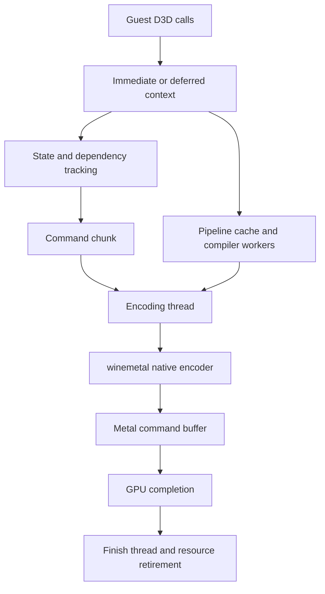

# DXMT and Metal graphics investigation

Pinned source and runtime limits: [architecture](architecture.md). D3D12 must be included to avoid attributing its behavior to DXMT D3D11.

## Actual rendering paths

| Guest API / bitness | Frontend and transition path | Shader / GPU path |
|---|---|---|
| D3D9 | Shim into native D3D9 frontend built by `build/dxmt-ios/build.sh`; pointer/layout conversion for x86 | DXSO/fixed-function shader generation → AIR/metallib → native Metal |
| D3D10/11 x64 | Native ARM64EC DXMT PE modules called from translated game; winemetal PE/Unix boundary | DXBC → native AIR compiler/LLVM → metallib → Metal pipelines |
| D3D10/11 x86 | i386 frontend/shim code can execute via FEX; WoW64 winemetal argument conversion | Native Unix Metal/shader services; guest-window-aware buffers |
| D3D12 x64 | `madeira-d3d12/src/pe/madeira_d3d12.c`, native ARM64EC runtime | DXIL via Metal Shader Converter; SM5 DXBC via in-tree AIR service; Metal through shared winemetal ABI |
| OpenGL/Vulkan | No general supported local path established by this trace | Do not assume DXVK/MoltenVK; app explicitly selects D3D11 for FNA because its default GL path is unavailable |

D3D versions present are not evidence of complete feature conformance. Capability probing, unsupported methods and compatibility gates still matter. Proprietary converter internals are unavailable. D3D12 in this tree is not stock DXMT or vkd3d.

## D3D11 call-to-submit trace

`d3d11_context_imm.cpp` records commands and handles dynamic/staging Maps; deferred contexts track dirty resource bindings (`d3d11_context_def.cpp:162–255`). The code has binding sets and state caches already; “add state caching” is not a source-specific recommendation. Profile redundant emitted binds or unnecessary dirtying by callsite before changing them.

`CommandQueue` starts encode, finish and event-listener threads. `CommitCurrentChunk` publishes work to the encoding thread and blocks only when bounded chunk capacity is exhausted. `CommitChunkInternal` creates a Metal command buffer, waits for initialization dependencies, encodes and commits. [dxmt/src/dxmt/dxmt_command_queue.cpp:21–45](https://github.com/willfaust/dxmt/blob/db546ee466ad50ec6463edb5fa183de11db43761/src/dxmt/dxmt_command_queue.cpp#L21-L45), [dxmt/src/dxmt/dxmt_command_queue.cpp:76–147](https://github.com/willfaust/dxmt/blob/db546ee466ad50ec6463edb5fa183de11db43761/src/dxmt/dxmt_command_queue.cpp#L76-L147). The finish thread waits for GPU completion, reports errors, completes tracked work, advances CPU-coherent sequence and recycles staging/temp/argument allocations: [dxmt/src/dxmt/dxmt_command_queue.cpp:151–213](https://github.com/willfaust/dxmt/blob/db546ee466ad50ec6463edb5fa183de11db43761/src/dxmt/dxmt_command_queue.cpp#L151-L213). Its `waitUntilCompleted` is **not evidence that the game thread stalls after every draw**.

The queue/initializer and render contexts track hazards and resource lifetimes. Native `winemetal_unix.c` implements ObjC Metal calls and batched encoder operations. D3D9's native variant resolves its internal WINE_UNIX_CALL to a direct table call; this existing boundary reduction should be preserved.

## Shader compilation and caching

D3D11 pipeline lookup uses shared shader lookup and separate state/pipeline locks. Cache misses submit `ThreadpoolWork` to a scheduler; `GetPipeline` waits until readiness. [dxmt/src/d3d11/d3d11_pipeline_cache.cpp:191–240](https://github.com/willfaust/dxmt/blob/db546ee466ad50ec6463edb5fa183de11db43761/src/d3d11/d3d11_pipeline_cache.cpp#L191-L240), [dxmt/src/d3d11/d3d11_pipeline_cache.cpp:382–455](https://github.com/willfaust/dxmt/blob/db546ee466ad50ec6463edb5fa183de11db43761/src/d3d11/d3d11_pipeline_cache.cpp#L382-L455), [dxmt/src/d3d11/d3d11_pipeline.cpp:49–56](https://github.com/willfaust/dxmt/blob/db546ee466ad50ec6463edb5fa183de11db43761/src/d3d11/d3d11_pipeline.cpp#L49-L56). Compilation is asynchronous, but first use still lies on a critical path when a pipeline is not ready.

The DXMT scheduler starts two workers and can grow to **twice reported hardware concurrency**, with time-critical priority requests: [dxmt/src/dxmt/dxmt_tasks.hpp:48–79](https://github.com/willfaust/dxmt/blob/db546ee466ad50ec6463edb5fa183de11db43761/src/dxmt/dxmt_tasks.hpp#L48-L79), [dxmt/src/dxmt/dxmt_tasks.hpp:131–146](https://github.com/willfaust/dxmt/blob/db546ee466ad50ec6463edb5fa183de11db43761/src/dxmt/dxmt_tasks.hpp#L131-L146). This can oversubscribe an iPad already running game jobs, FEX compilation, Wine, audio and UI. It is an **H**, not a proven bottleneck. **G2** introduces a bounded configurable worker budget and telemetry before deciding defaults. Preserve task continuation priority and dependency wakeups; a naive fixed tiny pool can worsen cold stutter.

### G1: 64-bit iOS cache-directory policy

`GetDXMTShaderCacheDirectory` returns a relative `dxmt/<exe>/` path unless explicitly given an absolute override. [dxmt/src/dxmt/dxmt_shader_cache.cpp:10–18](https://github.com/willfaust/dxmt/blob/db546ee466ad50ec6463edb5fa183de11db43761/src/dxmt/dxmt_shader_cache.cpp#L10-L18). On iOS, `use_ios_cache_dir()` defaults on only if `ios_wow_base()!=0`; otherwise relative paths use `_CS_DARWIN_USER_CACHE_DIR`. The source documents that lookup as unavailable in the sandbox. [dxmt/src/winemetal/unix/cache.c:25–92](https://github.com/willfaust/dxmt/blob/db546ee466ad50ec6463edb5fa183de11db43761/src/winemetal/unix/cache.c#L25-L92). Thus the 64-bit default does not get the implemented NSCachesDirectory resolver. Actual failure/hit rate still needs logs from a physical x64 session; an absolute configured path is an exception.

Concrete low-risk experiment: export `env.DXMT_IOS_CACHE_DIR = 1` using the existing configuration path; log effective directory and `DXMT_CACHE_STATS=1`; compare cold/second/third launches. Proposed permanent patch: enable the existing resolver for all iOS callers while preserving explicit `0`, absolute paths, failure fallback and bounded storage policy. This is primarily repeat-launch shader translation/stutter work, not a guaranteed warm steady-state FPS gain.

A separate correctness review should ensure cache identity covers the producing compiler/options. `kDXMTShaderCacheVersion=16` is a manually maintained schema version, not automatically a full compiler build hash. D3D12 already derives converter identity from build inputs; use that as a design reference rather than sharing incompatible caches.

### Metal binary archives

winemetal has archive creation/serialization and pipeline-descriptor archive fields: [dxmt/src/winemetal/unix/winemetal_unix.c:1385–1395](https://github.com/willfaust/dxmt/blob/db546ee466ad50ec6463edb5fa183de11db43761/src/winemetal/unix/winemetal_unix.c#L1385-L1395), [dxmt/src/winemetal/unix/winemetal_unix.c:1637–1650](https://github.com/willfaust/dxmt/blob/db546ee466ad50ec6463edb5fa183de11db43761/src/winemetal/unix/winemetal_unix.c#L1637-L1650), [dxmt/src/winemetal/unix/winemetal_unix.c:5416–5447](https://github.com/willfaust/dxmt/blob/db546ee466ad50ec6463edb5fa183de11db43761/src/winemetal/unix/winemetal_unix.c#L5416-L5447). Searching the inspected D3D11/DXMT frontend found no `BinaryArchive` usage; API support alone does not establish that a durable pipeline archive is wired into the active frontend. DXMT shader blobs and Metal's own compiler cache are distinct from an application-managed `MTLBinaryArchive`.

**G3**: after G1, measure residual Metal PSO construction time. If material, add per-device/OS-compatible archives keyed by complete pipeline descriptors and compiler identity, with safe miss fallback and idle serialization. Never treat a cached metallib as proof that pipeline construction is free. Avoid synchronous archive writes during gameplay.

## Unified memory and resource costs

Buffers use shared/private/managed abstractions; the iOS bridge normalizes platform behavior. `newBufferWithBytesNoCopy` is available when supplied host memory satisfies alignment/lifetime constraints; otherwise allocation is native. [dxmt/src/winemetal/unix/winemetal_unix.c:691–810](https://github.com/willfaust/dxmt/blob/db546ee466ad50ec6463edb5fa183de11db43761/src/winemetal/unix/winemetal_unix.c#L691-L810). WoW64 requires CPU-visible pointers within the guest window and explicit address conversion (`_MTLDevice_newBuffer32`, around 5700–5750). Native shared memory is not automatically a valid 32-bit guest pointer.

CPU-cached mappings are already the iOS default via `madeira_cpu_cache_mode`; write-combined can be restored with an opt-in switch: [dxmt/src/winemetal/unix/winemetal_unix.c:674–688](https://github.com/willfaust/dxmt/blob/db546ee466ad50ec6463edb5fa183de11db43761/src/winemetal/unix/winemetal_unix.c#L674-L688). Recommending this already-merged change as new work would be wrong. Unified memory also does not eliminate format conversion, synchronization, resource renaming or ownership.

Staging Map can rename storage and memcpy the entire resource to preserve unwritten bytes, or wait when a spare-memory budget is exhausted. A blocking read Map flushes queued work and waits for a CPU fence; counters distinguish unsubmitted versus already-submitted work. [dxmt/src/d3d11/d3d11_context_imm.cpp:240–307](https://github.com/willfaust/dxmt/blob/db546ee466ad50ec6463edb5fa183de11db43761/src/d3d11/d3d11_context_imm.cpp#L240-L307). **G4**: use those counters to identify excessive late flushes or avoidable full copies. Change only when the API proves full overwrite/discard or a valid earlier submission boundary. Returning early from readback, ignoring DO_NOT_WAIT, or recycling GPU-live storage is not an optimization.

D3D9 has buffer backing reuse, completion-tagged upload/constant rings, scene batching and load-time settle points. Source checks passed for batching, split locks and upload bounding. That is evidence these mechanisms exist and their host models behave as expected, not device speedups. Removing a flush at a query/readback/Present boundary can violate ordering even if EndScene batching is safe.

Texture formats are device capability-dependent. `supportsBCTextureCompression` is queried (`winemetal_unix.c:961–975,3459–3467`), and `dxmt_bcn.cpp` supplies decode work. Some devices need CPU decoding/expanded textures; do not apply phone/A16 observations to every M-series GPU. Profile streamed format conversions, bytes expanded and memory bandwidth before adding a GPU decode pipeline. Texture views and dirty bindings also have locks; replacing them requires complete resource-lifetime accounting.

Metal heaps are exposed by this bridge (`winemetal_unix.c:6590–6646`), including an unsupported WoW64 heap-at-offset path. Heap adoption must preserve alignment, resource residency, aliasing barriers and pointer reachability. It is **G6**, a longer-term hypothesis, not a quick global toggle. A private GPU resource can outperform a shared one despite unified physical memory; choose based on access patterns and measured costs.

## D3D12-specific serialization

`queue_ExecuteCommandLists` validates lists and either replays on the caller or enqueues a worker job. [madeira-d3d12/src/pe/madeira_d3d12.c:4920–4978](https://github.com/willfaust/Madeira/blob/48f976429c189f8396e23d251d8a82f43c705922/madeira-d3d12/src/pe/madeira_d3d12.c#L4920-L4978). `async-submit` defaults off: [madeira-d3d12/src/pe/madeira_d3d12.c:5372–5384](https://github.com/willfaust/Madeira/blob/48f976429c189f8396e23d251d8a82f43c705922/madeira-d3d12/src/pe/madeira_d3d12.c#L5372-L5384). The opt-in worker path already exists, so the next step is lifetime/order validation and benchmarking, not writing a second submit system.

Pipeline objects can be lazy. Before a batch, `mad_prebuild_pipelines` collects up to 256 not-yet-built PSOs and uses the caller plus up to three persistent workers. A **global serial lock** protects use of that prebuild pool and the call waits for its workers: [madeira-d3d12/src/pe/madeira_d3d12.c:2634–2709](https://github.com/willfaust/Madeira/blob/48f976429c189f8396e23d251d8a82f43c705922/madeira-d3d12/src/pe/madeira_d3d12.c#L2634-L2709). **G5** is a larger proposal: dependency-aware PSO jobs with per-PSO completion, optional prewarm after creation, and no global prebuild barrier across independent queues. Avoid compiling every unused PSO eagerly; preserve first-use synchronization and list/allocator ownership.

The default `fence-chain=1` serializes adjacent encoder stages conservatively; mode 6 is barrier-driven, mode 0 explicitly lacks synchronization and is documented to flicker. [madeira-d3d12/src/pe/madeira_d3d12.c:1468–1495](https://github.com/willfaust/Madeira/blob/48f976429c189f8396e23d251d8a82f43c705922/madeira-d3d12/src/pe/madeira_d3d12.c#L1468-L1495). Mode 0 is excluded. Mode 6 promotion requires a resource-hazard audit including attachment reuse, UAV/aliasing barriers and cross-list/queue dependencies. Newer Metal features are useful only if they address a measured dependency or bandwidth cost.

D3D12 DXBC/DXIL conversion caches and retry slots already exist (`madeira_ir_unix.mm:1217–1350`); converter identity is incorporated by `build/dxmt-ios/build.sh`. Its size-bound pruning currently runs from a write path, so **G7** asks whether pruning overlaps frame-critical work; moving eviction to idle must still enforce bounded growth and handle crashes.

## Presentation and GPU accounting

The inspected fork includes present submission and CPU mapping improvements referenced by PR #186. There is an optional producer limiter in winemetal (`MADEIRA_PRESENT_LIMITER`, around 3028–3054), independent of display/frame caps. Use a fixed cap and resolution for comparisons, and separately measure maximum throughput with caps disabled. Frame generation is experimental and off by default; generated frames must not be counted as improved guest render throughput.

`CommandQueue::AccountGpuTime` and the app meter use command-buffer GPU intervals. The union of overlapping intervals estimates busy wall time; summing queues double-counts overlap. Busy interval percentage is not shader occupancy. Frame time needs correlation among guest Present, encode/commit, GPU start/end and drawable presentation, not simply a reciprocal FPS average.

## Priorities

| ID | Evidence | Proposed change | Potential / effort / risk | Validation / owner |
|---|---|---|---|---|
| G1 | S: x64 skips iOS cache resolver by default | Enable existing resolver for all iOS callers with override and cache identity review | High for repeat-load stutter / low / low–medium | Multi-launch hits, PSO/translation ms and p99; Madeira integration + DXMT fork |
| G2 | H: up to 2×CPU compiler workers | Configurable bounded compiler budget; telemetry of active/queued tasks | Medium / medium / medium | Cold/warm scenes, CPU role times, audio/thermal behavior; DXMT fork |
| G3 | H: archive ABI exists but frontend hookup absent | Durable PSO archive after measuring misses | Medium / high / medium | Cold shader cache vs warm blob vs warm archive matrix; DXMT |
| G4 | C required copies/waits, H avoidable subset | Submission/renaming tuning only for API-proven cases | Medium / medium / medium–high | Map/query correctness, bytes/frame, unsubmitted waits; DXMT |
| G5 | C prebuild serialization, H gain | Per-PSO job graph; validate existing async submit separately | High in shader-heavy D3D12 loading / high / high | Multi-queue lifetime tests, first-use p99, PSO counts; Madeira D3D12 |
| G6 | H allocation/format cost | Profile first; targeted heap reuse/format strategy | Medium / high / high | Peak footprint, streaming/alias correctness and GPU capture; DXMT/D3D12 |
| G7 | H pruning on conversion write path | Defer bounded cache eviction to idle | Low–medium / medium / low–medium | Budget overflow/crash recovery plus frame-critical IO time; Madeira D3D12 |
